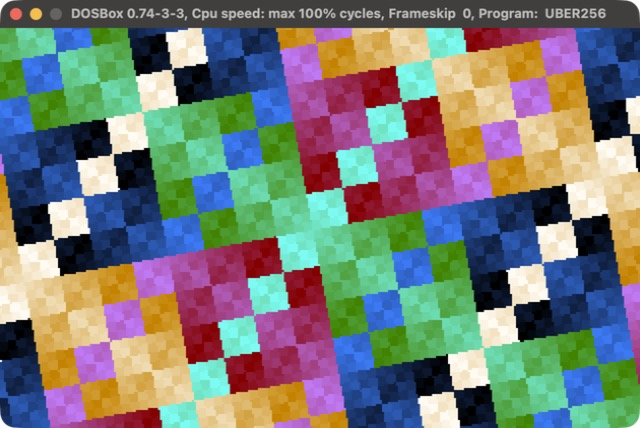

# UBER256

**A 171-byte DOS demo: an XOR rotozoomer, with no multiplies and no sine table.**

[](https://github.com/djayuffe/uber256-rotozoomer/actions/workflows/ci.yml)



171 bytes (class 256) of x86 assembly: an XOR texture rotating about the screen centre, with a dense rolling palette, at 70 fps.

| | |
|---|---|
| Size | **171 bytes** (class 256; a build gate stops it growing back) |
| CPU | 386+ (real mode) |
| Video | VGA mode 13h, 320x200x256, paced to vertical retrace |
| Audio | none |

## Run it

Download `UBER256.COM` from the [latest release](../../releases/latest) and run it in DOSBox
(`mount c .`, `c:`, `UBER256.COM`), or build it:

```sh
./build.sh        # NASM build + size gates
./run-dosbox.sh   # run it in DOSBox
```

Needs [NASM](https://www.nasm.us/) and [DOSBox](https://www.dosbox.com/)
(macOS: `brew install nasm` and `brew install --cask dosbox`).

**Esc** exits.

## How it works

DOS enters a `.COM` with `AX = 0` and `BX = 0`, so `mov al,13h` is a complete mode set and `BL` is a
ready-made palette index and frame counter. The VGA BIOS leaves the DAC write index at 0 after a mode
set, so the palette is simply streamed to port `3C9h` with no index setup, and the DAC keeps only 6 bits,
so `R = i, G = 2i, B = 4i` (one running value, two doublings) is a whole dense, saturated 256-colour
palette in 12 bytes. Esc is read straight from port `60h`; the frame is paced by one short wait for
vertical retrace.

An XOR texture (the top byte of `u ^ v`) rotating about the screen centre.

- **No multiplies, no sine table**: a vector `(c, s)` is rotated a little every frame by Minsky's trick
  (`c -= s>>5; s += c>>5`), which traces a near-perfect circle. The texture coordinates then just
  *accumulate*: `u += c`, `v += s` along a row, `u -= s`, `v += c` from row to row. Two `ADD`s per pixel
  replace four `IMUL`s (and make it about four times faster).
- **Centre without arithmetic**: the top-left corner's coordinates are the centre offset rotated by the same
  angle, so they go through the same Minsky step in the same loop as `(c, s)`. The rotation centre stays
  within about 3 pixels of the screen centre (the test measures it).
- **16.16 fixed point in 32-bit registers**: with 16-bit values the truncation in the shifts made the circle
  spiral inwards within seconds. (The first attempt at this hack did exactly that; the test caught it.)
- **Data through `BX`**: `[bx]`, `[bx+4]`, ... are 2-3 byte operands. Only the initial vector is in the file;
  the row accumulators and the colour counter need no initial value and are not stored.

It started at 237 bytes with a zoom pulse, four `IMUL`s per pixel and a 43-byte palette.

## Testing

`tests/run_tests.sh` runs the real binary in an emulated 16-bit CPU (Unicorn), entered the way DOS enters
a `.COM`. It checks the size gates, mode 13h in and text mode out, the palette, a full animated page every frame, a clean Esc exit, and that it stays inside its segment. It also reads the rotation state: the `(c, s)` vector keeps a constant length (within 2%) over 300 frames, really rotates, and the rotation centre stays within 4 pixels of the screen centre. CI runs it on every push; a `vX.Y.Z` tag publishes a release.

## Related

Part of a small family of DOS size-coding demos, each in its own repository:
[uber10-dos-demo](https://github.com/djayuffe/uber10-dos-demo) (10 bytes),
[uber128-dos-demo](https://github.com/djayuffe/uber128-dos-demo) (77 bytes),
[uber256-rotozoomer](https://github.com/djayuffe/uber256-rotozoomer) (171 bytes),
[uber256-dos-intro](https://github.com/djayuffe/uber256-dos-intro) (131 bytes), and the big one,
[uber40k-dos-demo](https://github.com/djayuffe/uber40k-dos-demo) (a 20-scene show with a 3D engine and
Sound Blaster music). The index is [uber-tiny-demos](https://github.com/djayuffe/uber-tiny-demos).

## License

MIT
